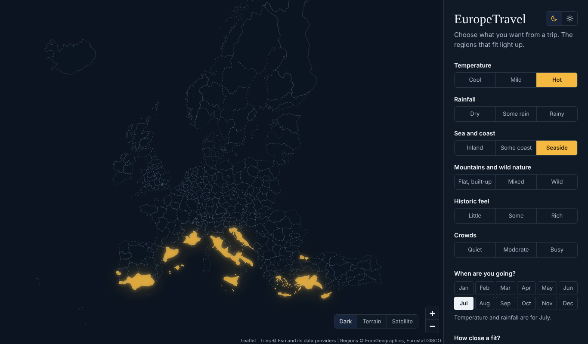
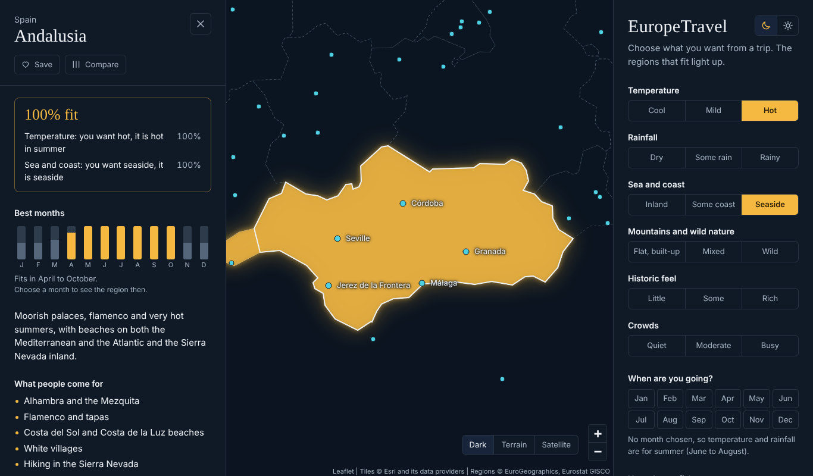
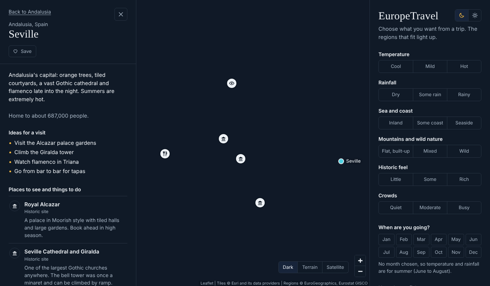
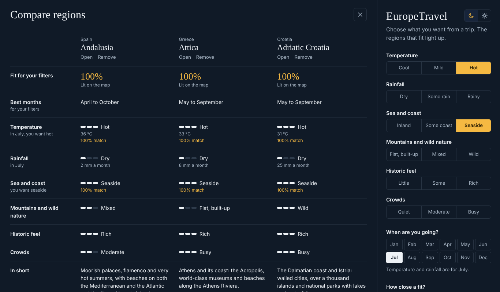
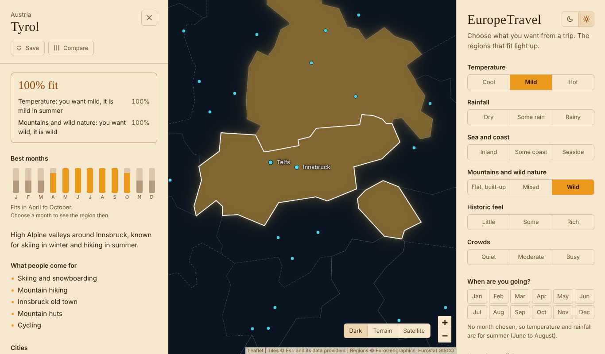

# EuropeTravel

Find where to travel in Europe: filter by climate, coast, nature, and history, and see matching regions glow on the map.

Pick what you want from a trip (hot or cool, seaside or inland, quiet or busy, a month to travel in). Every region of Europe is scored against those choices, and the ones that fit light up on a dark map. Click a region for its climate and cities, click a city for places to visit.

Term project for the course "Web Programming with Python and Git".



## What it does

- **Filters.** Temperature, rainfall, sea and coast, mountains and wild nature, historic feel, crowds, plus a month and a "how close a fit" line.
- **Region card.** Why the region fits, which months fit best, its climate through the year and its main cities.
- **City card.** Notes on the city and places to see, as pins on the map and a list beside it.
- **Compare.** Two or three regions side by side.
- **Saved.** Keep regions and cities in a list. It stays in your browser.
- **Links.** The address follows what you are looking at, so a copied link opens the same view for someone else.
- **Looks.** A night and a warm theme, and dark, terrain and satellite base maps.

| | |
|---|---|
|  |  |
|  |  |

The pictures were taken where the base map could not load, so the background behind the regions is empty. `STATUS.md` says what else has not been checked.

## Run it

You need Python 3.10 or newer and an internet connection (the base map and fonts come from other servers).

**The short way.** On Windows, double-click `run.bat`. On Mac or Linux, run `./run.sh`. The first run sets everything up, then the app opens in your browser.

**By hand.**

```bash
git clone https://github.com/Marcelius134/EuropeTravel.git
cd EuropeTravel
python -m venv venv
source venv/bin/activate        # Windows: venv\Scripts\activate
pip install -r requirements.txt
flask run
```

Then open http://127.0.0.1:5000.

The repository already contains the data the app needs, so it works straight after cloning. Climate and heritage are only filled in for 46 well-known regions until you run the data build below.

## Fill in the rest of the data

Climate, heritage scores, city notes and places are downloaded from free public services. The downloads have to run on your own computer.

```bash
pip install -r requirements-data.txt
python -m scripts.build_data all
```

This takes roughly 20 to 30 minutes, most of it polite waiting between requests. It can be stopped and started again; finished downloads are kept in `data/cache/`. When it ends, commit the changed files under `data/` and push.

You can also run one step at a time:

| Step | What it does | Needs internet |
|---|---|---|
| `boundaries` | Downloads the NUTS-2 outlines and writes `static/geo/nuts2.geojson` | yes |
| `geometry` | Area, coast and mountain share from the outlines | yes, first time |
| `cities` | Picks the main cities per region and measures how built-up each region is | no |
| `climate` | Monthly temperature and rainfall for every region | yes |
| `heritage` | World Heritage sites and castles per region | yes |
| `places` | City notes and places to visit | yes |
| `merge` | Combines everything into the files the app reads | no |

`merge` runs automatically after any other step. If one step fails, the others still run and the script tells you which to retry.

## How it works

```
 Browser                         Flask (app.py)                Data
 ───────                         ──────────────                ────
 static/js/app.js     ──────▶    /api/meta
   filter panel, map,            /api/match     ──▶ matcher.py ──┐
   region card                   /api/regions                    │
 static/js/cities.js  ──────▶    /api/cities    ──▶ store.py ────┼──▶ data/regions.json
   city dots, city card                                          │    data/cities.json
 static/js/places.js                                             │    data/places.json
   place pins and list                                           │
                                                                 │
 scripts/build_data.py  ─────────────────────────────────────────┘
   downloads and computes, then writes the three JSON files
```

1. The page asks `/api/meta` which filters exist and draws the panel from the answer.
2. Each time a filter or the month changes, the page posts the choices to `/api/match`.
3. `matcher.py` scores all 328 regions and returns the list, best first.
4. The page lights up every region at or above the fit threshold. Moving the threshold slider needs no new request.
5. Clicking a region, city or place asks the API for that one record.

The scoring rule is described in `SCHEMA.md`. All of it lives in `matcher.py`, which has no Flask code in it and can be read and tested on its own.

## Project layout

```
app.py              Flask app: pages and JSON API
matcher.py          Filter definitions and scoring
store.py            Loads the JSON data files
templates/          The single HTML page
static/css/         Styles
static/js/          app.js (map, filters, regions) and one file per feature:
                    cities.js, places.js, year.js, compare.js, saved.js, share.js
static/geo/         Region outlines (generated)
static/vendor/      Leaflet 1.9.4
data/               regions.json, cities.json, places.json (generated)
data/computed/      Measured values, one file per build step
data/curated/       Hand-written values
scripts/            The data build
tests/              pytest tests; tests/browser/ drives a real browser
docs/               Tasks for the team, screenshots
run.bat, run.sh     Set up and start in one step
```

## API

| Method and path | Returns |
|---|---|
| `GET /api/meta` | Filter names, level labels, month names, default threshold |
| `POST /api/match` | Body `{"filters": {"coast": "high"}, "month": 7}`. A score per region |
| `GET /api/regions` | Id, name and country of every region |
| `GET /api/regions/<id>?month=7` | One region with climate, levels and cities |
| `POST /api/regions/<id>/year` | Body `{"filters": {...}}`. The region's score in each of the twelve months |
| `GET /api/cities` | Every city, briefly |
| `GET /api/cities/<id>` | One city with notes and places |

## Test it

```bash
pytest
```

The tests cover the scoring, the API, the consistency of the data files, and the parsing and download handling in the build scripts. They never use the network.

Twenty more tests drive the page in a real browser. They are skipped unless Playwright is installed:

```bash
pip install -r requirements-browser.txt
playwright install chromium
pytest tests/browser
```

## Where the data comes from

| Data | Source | Licence |
|---|---|---|
| Region outlines | Eurostat GISCO NUTS 2021, via [Nuts2json](https://github.com/eurostat/Nuts2json) | © EuroGeographics for the administrative boundaries |
| Coastline, mountain ranges | [Natural Earth](https://www.naturalearthdata.com) | Public domain |
| Cities and populations | [GeoNames](https://www.geonames.org), via the `geonamescache` package | CC BY 4.0 |
| Climate | [NASA POWER](https://power.larc.nasa.gov), with [Open-Meteo](https://open-meteo.com) as a fallback | Free to use, credit required |
| Heritage counts | [Wikidata](https://www.wikidata.org) | CC0 |
| City notes and places | [Wikivoyage](https://en.wikivoyage.org) | CC BY-SA 4.0 |
| Base maps | Esri (dark gray, terrain and satellite) | Credit shown on the map |
| Map library | [Leaflet](https://leafletjs.com) | BSD 2-Clause |

Some values are hand-written estimates rather than measurements. `STATUS.md` lists which, and every record in the data files says where each of its values came from.

## Links to a view

The address holds the view, so it can be bookmarked or sent:

```
/?temperature=high&coast=high&month=7&fit=80&region=ES61
```

| Part | Meaning |
|---|---|
| `temperature`, `rainfall`, `coast`, `nature`, `historic`, `crowd` | `low`, `medium` or `high` |
| `month` | 1 to 12 |
| `fit` | The fit line, 50 to 95 |
| `region` or `city` | The open card, for example `ES61` or `seville-es` |
| `map` | `terrain` or `satellite` |
| `compare` | Region ids separated by commas; add `show=compare` to open the table |

Anything unknown in a link is ignored.

## Working on it

Start with `HANDOVER.md`: where everything lives and how to change it. Then:

- `docs/tasks.md`: what is left, as ready-to-paste issues
- `STATUS.md`: what is done, what runs on estimates, what has not been checked
- `SCHEMA.md`: the data format and the scoring rule
- `CONTRIBUTING.md`: the Git workflow
